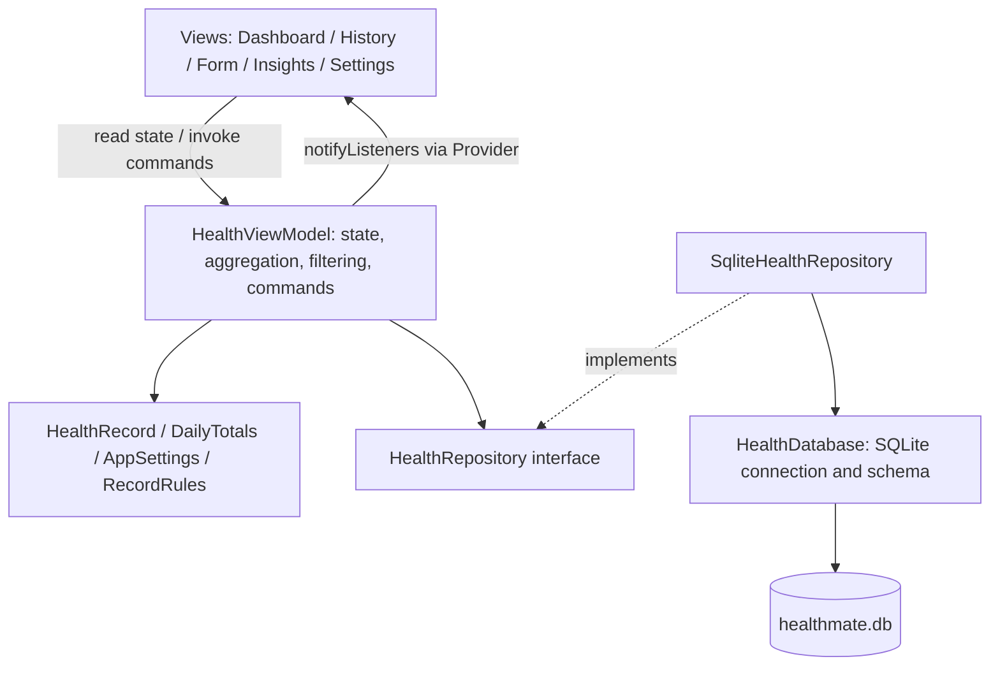
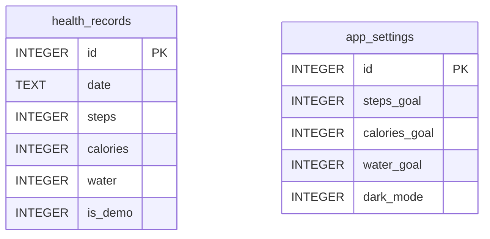

# HealthMate technical guide

## Scope and behavior

HealthMate is a manually entered personal wellness journal. It implements the HealthMate coursework's three measures: steps, calories burned (kcal) and water intake (ml). The database permits several entries per date. Dashboard and chart values are sums for a local calendar day. Date-only strings avoid timezone conversion changing the day of an entry.

## Requirements mapping

| Brief requirement | Implementation |
|---|---|
| Dashboard | Today totals, date, daily goal progress, recent entries and streak |
| Add health entries | Log activity form; date picker and validated numeric fields |
| Past record list | History screen, descending date/id order |
| Edit/delete | Record action menu, shared edit form, deletion confirmation |
| Date search/filter | Exact date, today, inclusive range and clear filter |
| sqflite | HealthDatabase and SqliteHealthRepository |
| Architecture/state | Feature-based MVVM, repository abstraction, Provider and ChangeNotifier |
| Dummy records | Opt-in transactional 14-day dataset, marked and separately removable |
| Extras | Goals, theme persistence, period charts, statistics, streak and water increment chips |
| Testing | Unit, real SQLite, widget and device integration suites |
| Version control | Local Git repository with actual stage commits |

## Architecture

The application uses a shared ViewModel because all five features display or mutate the same small personal dataset. Each feature's views are located together. Database creation belongs in core infrastructure; record data access belongs in the records feature. UI widgets never execute SQL. The repository interface allows in-memory test doubles, while SQLite tests use the actual schema with the FFI database factory.

`main.dart` constructs dependencies and starts an asynchronous initial load after mounting the app. Provider exposes the ViewModel; `context.watch` and Consumer rebuild views after notification. Mutations are awaited and guarded by `busy`. A failed operation displays a recoverable message. A separate readiness flag distinguishes database-open failures from a failed form submission. The app refreshes its date on resume and once per minute while mounted, so a midnight transition updates the dashboard without rewriting dates.

## SQLite schema

These tables are independent. `app_settings` has exactly one row (id 1); no foreign key is needed. `is_demo` is a small extension to the required health_records fields, allowing safe sample removal. See the complete schema in `lib/core/data/health_database.dart`.

| Field | Meaning / constraint |
|---|---|
| id | Autoincrement record primary key |
| date | Local date as YYYY-MM-DD; indexed for future query scaling |
| steps | Whole number, 0 to 200,000 per entry |
| calories | Whole kcal, 0 to 30,000 per entry |
| water | Whole ml, 0 to 20,000 per entry |
| is_demo | 0 personal / 1 sample |

At least one activity must exceed zero. Dates must be from 1 January 2000 through the device's current local day. Numeric limits are input-sanity limits, not recommended health targets. Validation exists in the form and domain layer. SQLite additionally rejects invalid numeric ranges and all-zero activities even when the UI is bypassed. A future migration should increment the schema version and add an onUpgrade migration, preserving user records.

## CRUD and data flow

Create: the form validates strings, constructs an immutable HealthRecord and invokes `vm.save`. The repository validates again and calls `db.insert`. SQLite generates an id. The ViewModel reloads records and notifies listeners.

Read: `db.query('health_records', orderBy: 'date DESC, id DESC')` returns maps which become HealthRecord objects. Date filtering and aggregation are performed in memory for this small offline journal. For a very large dataset, use parameterized SQL date queries and pagination.

Update: the form is prefilled with the original record. Its id and demo status are preserved. The repository uses `db.update(..., where: 'id = ?', whereArgs: [record.id])`. An update that finds no row raises an error instead of silently claiming success.

Delete: after explicit confirmation, the repository runs `db.delete(..., where: 'id = ?', whereArgs: [id])`. Parameterized arguments separate data from SQL. Totals and charts recalculate after reload.

Demo loading: a transaction removes existing demo rows and inserts 14 relative daily records. It never deletes personal rows. Repeated demo loading produces 14 sample rows rather than duplicates. Sample totals are clearly disclosed in the dashboard and insights.

## Statistics rules

- Today's total: sum all entries matching the current local date.
- Goal progress: actual / personal goal; visual bar is capped at 100%, while the label can exceed 100%.
- Periods: the latest 7 or 30 calendar days including today.
- Daily average: period total divided by 7 or 30, including unlogged days.
- Active days: number of distinct dates with at least one entry within the period.
- Streak: consecutive recorded days ending today; if today is empty, yesterday can anchor the current streak.
- Highest day: largest daily sum for the selected metric; the earliest matching date wins ties.
- Missing records represent unlogged activity, not proof of zero real activity.

## UI and UX

The four persistent destinations are Today, History, Insights and Settings. A floating Log activity button appears on Today and History. Add/edit is a separate route. This keeps primary navigation predictable and reuses one form for both operations.

The palette uses teal for steps, warm orange for calories and blue for water. Icons and written units accompany colour, so meaning does not depend on colour alone. Cards group related metrics; content is capped at 760 logical pixels on wider screens. Forms scroll above the keyboard, and buttons are disabled during mutations. Empty states explain what to do next. Confirmation prevents accidental deletion and loss of unsaved form changes. Charts include semantic labels and tappable numeric tooltips.

Light/dark themes use Material 3. The app includes SafeArea handling and narrow-width large-text regression tests. iOS scaffolding is present, but iOS visual and device verification still needs a Mac. Add any further device-specific evidence to the report after actually testing it.

## Packages and justification

| Package | Reason |
|---|---|
| Flutter Material | Native-rendered reusable controls, layout, navigation, accessible components |
| provider | Supplies ChangeNotifier state to feature views without coupling views to SQL |
| sqflite | Required embedded SQLite plugin on Android/iOS |
| path | Platform-safe database path construction |
| intl | Date and number formatting |
| flutter_test | Model, ViewModel, widget and layout tests |
| sqflite_common_ffi | Real SQLite operations on the Windows test host |
| integration_test | Android end-to-end workflow and screenshot capture |

Charts use Flutter widgets, avoiding an unnecessary chart dependency for three simple bar series. Actual resolved versions are in pubspec.lock, which should stay committed for reproducibility.

## Limitations and future improvements

Data is stored locally with no cloud sync, authentication, export or encrypted database. No background reminders, step sensors or medical calculations are claimed. App-private storage and disabled Android backup reduce unintended sharing but are not a substitute for a security review. Larger datasets could benefit from paginated queries. Production distribution needs proper release signing, privacy review and broader device/accessibility testing.

## Development issues and fixes

- The Flutter batch launcher initially stalled; invoking the installed Flutter snapshot allowed toolchain checks and builds without changing the user's SDK files.
- Analyzer feedback required braced flow-control blocks; these were fixed rather than disabling lints.
- The large-text 360-pixel layout test exposed an app-bar title overflow. The wordmark was made flexible to fit the available space.
- The initial save error state was separated from database initialization readiness, so invalid input cannot replace an otherwise working home screen with a database retry state.

- A repeat Gradle build encountered a OneDrive AccessDenied error while replacing native libraries. A temporary build folder avoids syncing/locking the intermediate outputs, while the project and final APK remain on the Desktop.

Only report issues and fixes that you can explain and reproduce. Automated evidence should be described as automated.

## References for the report

Flutter (n.d.) *App architecture*. Available at: https://docs.flutter.dev/app-architecture (Accessed: 18 October 2026).

Flutter (n.d.) *Persist data with SQLite*. Available at: https://docs.flutter.dev/cookbook/persistence/sqlite (Accessed: 18 October 2026).

sqflite contributors (n.d.) *sqflite*. Available at: https://pub.dev/packages/sqflite (Accessed: 18 October 2026).

Provider contributors (n.d.) *provider*. Available at: https://pub.dev/packages/provider (Accessed: 18 October 2026).

Use your institution's exact Harvard format and add references for anything else you use.

