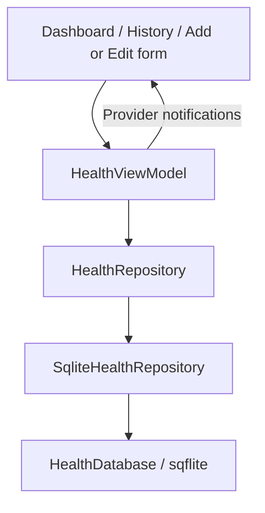

# HealthMate technical guide

## Scope

The app implements the coursework's core functions: add, view, edit and delete daily health entries, filter history by date and display today's totals. Inputs are steps, calories burned in kcal and water in ml. Test records are entered through the normal Add record form. The header sun/moon button switches light and dark themes for the current session. Goals, statistics, charts and streaks are omitted.

## Architecture

Views handle presentation and form interaction. The ViewModel owns loaded records, loading/error state, date filtering and daily aggregation. The repository performs parameterized CRUD operations. HealthDatabase creates and opens SQLite. main.dart constructs dependencies. Models and validation live in records/domain; views and state live in records/presentation; data access lives in records/data. Shared UI and database infrastructure are in core.

## Database

| Field | Meaning |
|---|---|
| id | Integer primary key, generated automatically |
| date | Local date stored as YYYY-MM-DD text |
| steps | Whole steps walked |
| calories | Whole calories burned, kcal |
| water | Whole water intake, ml |
| is_demo | Internal flag for safely identifying test samples |

The date column is indexed. Several rows may share a date and are summed for the dashboard. SQLite CHECK constraints reject negative, excessive and all-zero values. Date validation rejects future dates and dates before 2000. Version 2 drops only the former app_settings table; it preserves health_records and their IDs.

## CRUD

Create uses db.insert. Read uses db.query with descending date/id order. Update and delete use `where: 'id = ?'` and `whereArgs: [id]`. Each successful mutation refreshes the ViewModel and notifies listening widgets. The form validates text before constructing a HealthRecord, and the repository validates numeric values again. Error messages and a busy flag handle failures and repeated taps.

Legacy sample helpers and flags remain internally for compatibility and repository tests; there is no sample loading or removal menu in the app. Existing records are preserved. The brief asks for dummy records for initial testing, not a dedicated sample-data menu.

## UI

A simple Material layout uses two navigation destinations and a shared Add/Edit route. Green, red and blue icons distinguish steps, calories and water. Each metric includes a written label and unit. History has one exact-date picker and a Show all button. Delete and unsaved-form confirmations prevent accidental loss. Scrolling and constrained widths support narrow screens and larger text.

## Packages

Provider supplies ViewModel state to widgets. sqflite stores data locally; path constructs the database path. intl formats dates/numbers. flutter_test covers models, database access and widgets; sqflite_common_ffi runs actual SQLite tests on the host. integration_test supports an Android workflow. Package versions are locked in pubspec.lock.

## Verification and limitations

See TEST_CASES.md and verification logs for measured results. The database migration has a test specifically checking old records survive. Windows builds use a local cache junction to avoid OneDrive output-directory deletion failures. Data is manually entered and stays local; the app has no sensors, login, cloud synchronization or backup/export feature. iOS needs separate verification on a Mac.

## References

Flutter (n.d.) App architecture. https://docs.flutter.dev/app-architecture (Accessed 18 October 2026).

Flutter (n.d.) Persist data with SQLite. https://docs.flutter.dev/cookbook/persistence/sqlite (Accessed 18 October 2026).

sqflite contributors (n.d.) sqflite. https://pub.dev/packages/sqflite (Accessed 18 October 2026).

Provider contributors (n.d.) provider. https://pub.dev/packages/provider (Accessed 18 October 2026).

